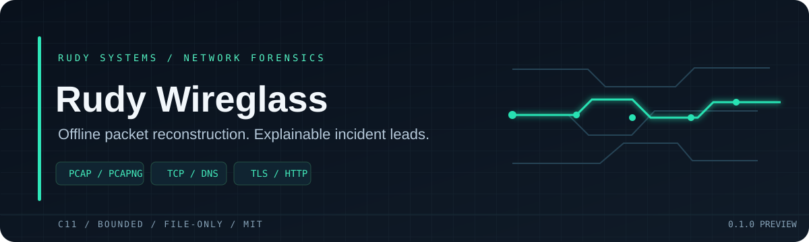

  

**An offline packet-forensics engine for incident responders.**

Rudy Wireglass turns PCAP and PCAPNG files into a compact, explainable view of network conversations. It reconstructs bounded TCP metadata, extracts DNS answers, HTTP hosts and TLS ClientHello metadata, and flags a small set of reviewable behavior patterns. The core is written in portable C11 with no runtime dependencies.

## What it does

- Reads classic PCAP (microsecond and nanosecond timestamps) and PCAPNG sections, interfaces, enhanced packets and simple packets.
- Decodes Ethernet/VLAN, raw IP, Linux cooked captures, IPv4/IPv6, TCP, UDP and DNS A/AAAA answers.
- Builds bidirectional conversation summaries with byte/packet direction, TCP flags, timing, and sequence-gap counts.
- Extracts HTTP Host and TLS ClientHello SNI/ALPN from bounded TCP streams, including contiguous segmented handshakes.
- Emits explainable leads for unusually long, high-entropy DNS labels and strongly regular flow timing.
- Produces readable text or stable JSON for case notes and downstream tooling.
- Applies configurable file, packet, flow and stream bounds. Malformed lengths are rejected before packet data is accessed.

Indicators are triage leads, not verdicts. A long DNS label or regular connection can be normal software behavior. See the design and analysis contract in docs/DESIGN.md for thresholds and parser boundaries.

## Build

Requires a C11 compiler and CMake 3.20 or newer. No libpcap installation is required.

    cmake -S . -B build -DCMAKE_BUILD_TYPE=Release
    cmake --build build --config Release
    ctest --test-dir build --output-on-failure

The executable is build/wireglass on Unix-like systems and build/Release/wireglass.exe with a multi-configuration Windows generator.

## Run

    wireglass scan capture.pcapng
    wireglass scan capture.pcap --format json --output report.json
    wireglass scan capture.pcap --max-packets 500000 --max-flows 4096 --strict

Strict mode returns exit code 1 if a configured heuristic emitted a finding. Parse or output errors return 2; a completed scan without strict findings returns 0. Use --help for all options.

### Included synthetic capture

examples/demo.pcap contains a small, synthetic DNS lookup and TLS ClientHello using documentation-only IP addresses. Try:

    wireglass scan examples/demo.pcap
    wireglass scan examples/demo.pcap --format json

Recreate it with python examples/create_demo.py; the script uses only Python's standard library and is a fixture generator, not part of the analyzer.

## JSON shape

The versioned rudy-wireglass/v1 report includes capture counters and link types, bidirectional flow records, DNS messages, extracted application metadata and findings with stable rule IDs. Fields that were not observed are empty strings or zero-valued counters. Consumers should tolerate added fields in future schema revisions.

    {
      "schema": "rudy-wireglass/v1",
      "capture": { "format": "pcap", "packets_seen": 2, "flow_count": 2 },
      "flows": [{ "protocol": "tcp", "tls_sni": "updates.example.net", "tls_alpn": "h2" }],
      "findings": []
    }

See docs/REPORT.md for field meaning and exit codes.

## Security and privacy

Wireglass opens a local file and writes a local report. It does not capture live traffic, create network connections, resolve names, send packets, modify evidence, or contact external services. Capture files may contain credentials, personal data and internal hostnames; handle reports as sensitive evidence and sanitize samples before sharing them.

The parser is intentionally bounded. It rejects malformed capture block and packet lengths, caps per-packet memory, limits flow-table size, and limits TCP metadata buffers. Review SECURITY.md for reporting parser vulnerabilities.

## Current boundaries

Wireglass does not reassemble IP fragments or arbitrary out-of-order TCP streams, decrypt TLS, parse QUIC, verify checksums, or fully decode every PCAPNG option. Unsupported packets are counted. A sequence gap resets the relevant metadata buffer and is included in the flow summary. Do not treat missing metadata as proof of absence.

## Project

**RUDY Systems · Network forensics**  
[Project home](https://rudy.systems) · [Issues](https://github.com/r4venrudy/rudy-wireglass/issues) · [Security policy](SECURITY.md)

MIT licensed. See CONTRIBUTING.md to build, test and contribute.
